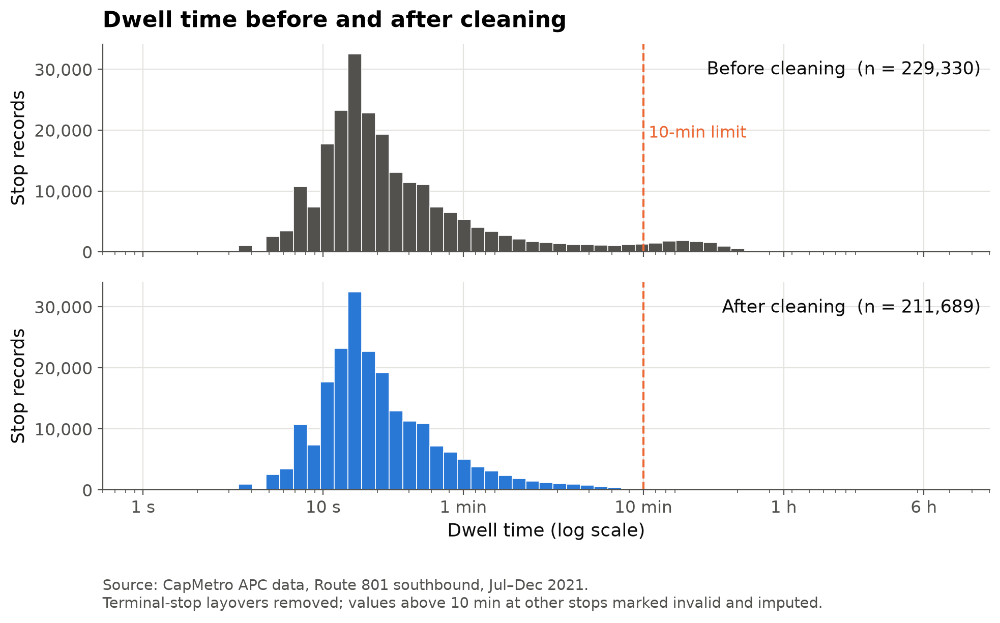

# Methodology

*Owner: Rence*

## Data acquisition

The dataset was downloaded whole and then narrowed to a single route and direction, so that every
record compared in this report is produced under the same operating conditions.

- **Source:** Capital Metropolitan Transportation Authority (CapMetro), *APC Raw July 2021 – December 2021*, Texas Open Data Portal (dataset `im6q-3pc9`), free public download.
- **How the data is produced:** automatic passenger counters (APC) on CapMetro buses. Door sensors count passengers getting on and off, and the bus's GPS and clock record when and where each stop happens. Each row is one **stop event**: one bus stopping at one stop.
- **Raw size:** 9,197,694 rows × 47 columns, covering every CapMetro route. All values are stored as text.
- **Study subset:** Route 801 (CapMetro Rapid), southbound, **July 1 – December 30, 2021**: 229,421 stop events (229,414 once duplicates are removed), 29 stops, 143 buses, 183 service days.

## Parameters used to segregate the data

The records were grouped along the parameters below. The analysis window is the most important of
them: outside 7:00–17:59 the planned headway is no longer 10 minutes, so an uneven gap would say
nothing about bunching.

| Parameter | Values used | Purpose |
|---|---|---|
| Route | 801 | Study route |
| Direction | Southbound (code 6) | One direction of travel |
| Period | Jul 1 – Dec 30, 2021 | Full dataset coverage |
| Day type | Weekday / weekend | Compare demand patterns |
| Analysis window | Weekdays, 7:00–17:59 | Hours when buses are scheduled every 10 minutes, so the planned headway is constant |
| Hour of day | 0–23 | Demand by time of day |
| Stop order | 1 (first stop) to 29 (last stop) | Position along the route |
| Headway group | 0–5, 5–10, 10–15, 15–20, 20+ min | Compare buses that are close together vs far apart |

**Key variables**

- **Headway:** time since the previous bus at the same stop.
- **Passenger load:** passengers on board after the stop (`max_load`).
- **Boardings / alightings:** `ons` / `offs`.
- **Dwell time:** seconds from door open to door close.

## Data cleaning

Raw APC data contains records from other routes, buses running off their assigned route, sensor
errors and trips the system failed to log. Cleaning removes each of these in turn, so that the
patterns reported later are properties of the service rather than of the measuring equipment.

**Filtering.** A record is kept only if it passes all six rules:

| Step | Rule | Records left |
|---|---|---|
| Raw dataset | — | 9,197,694 |
| 1 | Route 801 | 547,616 |
| 2 | Bus serving its assigned route | 524,728 |
| 3–4 | No error flags (record or trip) | 480,452 |
| 5 | Valid stop ID (not 0) | 455,654 |
| 6 | Southbound only | **229,421** |

**Other cleaning steps**

- **Type conversion:** text is converted to numbers and dates.
- **Duplicates:** 7 duplicate records (same trip, same stop) are removed.
- **Terminal stops:** stops 1 and 29 are the ends of the route, where buses wait between trips. Their "dwell times" are layovers (median 10–13 minutes), so the 17,659 terminal records are excluded from the dwell and headway analysis (see the figure below).
- **Invalid values:**
  - Boardings or alightings above 40 at a single stop (33 values, above the 99.99th percentile) are counter errors.
  - Dwell times above 10 minutes at non-terminal stops (381 values) are not passenger service.
  - Both are marked as missing.
- **Imputation:** the missing values are filled with the **median of the same stop and hour**. The median is used because these variables are strongly skewed. In total 414 values were imputed, less than 0.2% of records.
- **Headway check:** some scheduled trips are missing from the APC data, so two recorded buses can be 20 minutes apart only because the bus between them wasn't recorded. A headway is therefore kept only when the two buses were **scheduled exactly 10 minutes apart**. This leaves 51,437 valid headways in the analysis window.

## Tools

Python (pandas, NumPy, Matplotlib, SciPy, statsmodels). The full pipeline is in `src/prepare_data.py`.
