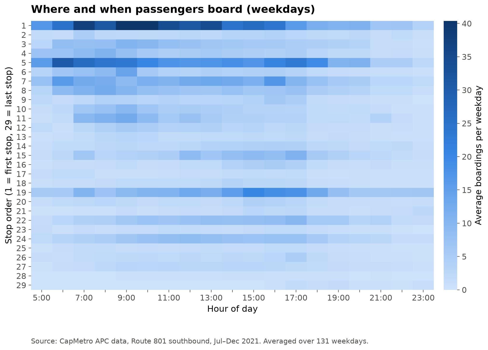

# Where and when passengers board

- **Stop 1** is busiest: about 442 boardings per weekday, peaking 7:00–10:00
- **Stop 5** peaks in the morning; **stop 19** in the afternoon (15:00–17:00)
- Most stops after stop 20 have few boardings
- Demand is very uneven across stops and hours
