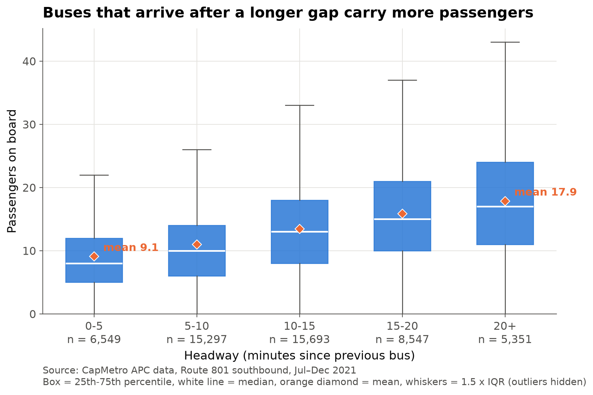
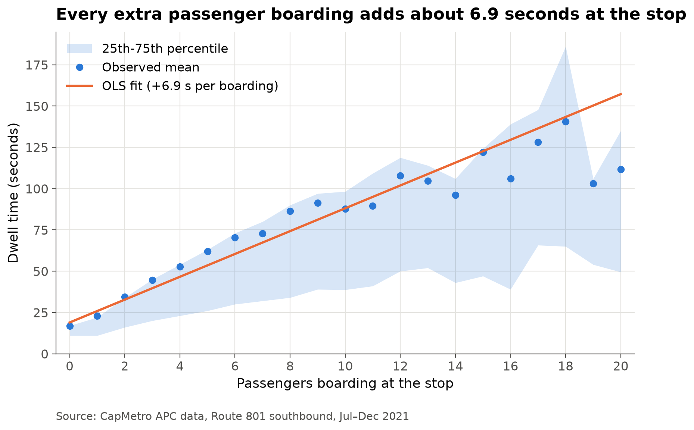
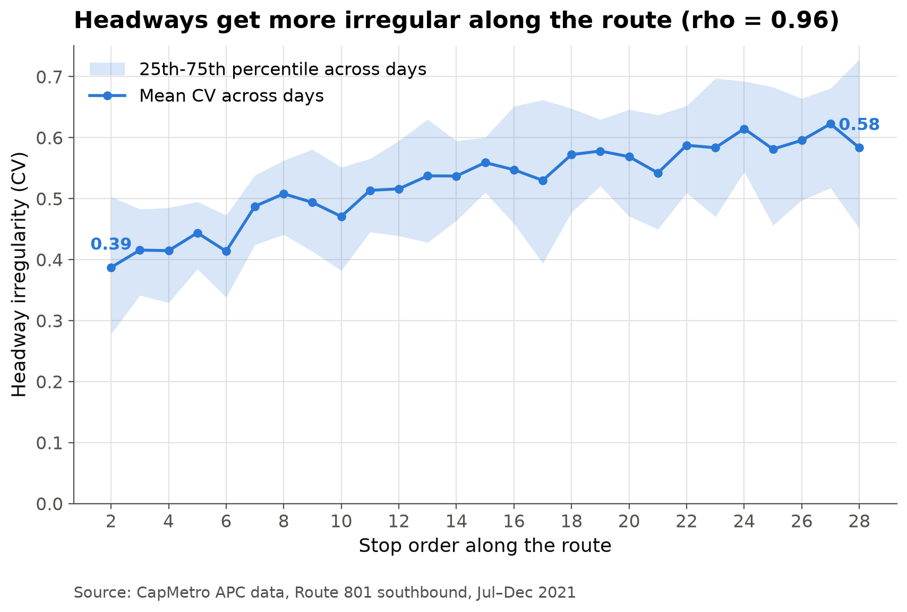

# Results: hypothesis tests

*Owner: Khalil · Notebook: `notebooks/03_hypotheses.ipynb`*

All tests use the analysis window (weekdays 07:00–17:59, buses scheduled every 10 minutes):
126,070 stop events over 131 service days. Every test uses a significance level of **alpha = 0.05**.

## H1 — Buses with a longer headway carry more passengers

*Figure: `figures/fig06_h1_load_vs_headway.png`*

- Mean load climbs with every headway group: **9.1 passengers** at 0–5 min (n = 6,549), 11.0 at 5–10, 13.4 at 10–15, 15.8 at 15–20 and **17.9** at 20+ min (n = 5,351) — roughly **double** the load for a bus that is 20+ minutes behind the one ahead.
- The medians move the same way (8 → 17 passengers), so the pattern is not driven by a few crowded buses.
- **Spearman correlation:** rho = **0.349**, p < 0.001 (n = 51,437 valid headways) — a moderate positive association.
- **Kruskal-Wallis:** H = **5,883.4**, df = 4, p < 0.001. Both tests are below alpha = 0.05, so we **reject H0**: load does depend on the headway.

## H2 — More boardings and alightings mean longer dwell time

*Figure: `figures/fig07_h2_dwell_vs_boardings.png`*

- OLS on 116,697 non-terminal stop events: `dwell_time = 12.79 + 6.91 × ons + 3.65 × offs` (seconds). Each extra **boarding adds about 6.9 s** (95% CI 6.81–7.02) and each **alighting about 3.7 s** (95% CI 3.54–3.76) — boarding costs about **1.9× as much time** as alighting, which fits the fact that boarding passengers queue at the front door to pay while alighting passengers simply step off.
- Both coefficients are significant (p < 0.001 each; F(2, 116694) = 12,777, p < 0.001), so we **reject H0**. **R² = 0.180**: boardings and alightings explain 18% of the variation in dwell time, the rest comes from traffic, wheelchair ramps and driver behaviour.
- Observed mean dwell rises from **16.9 s with no boardings to 111.8 s at 20 boardings**, and the 25th–75th band widens with it, so busy stops are both slower and less predictable.
- The straight fit runs above the observed means past ~15 boardings (fitted 157 s vs observed 112 s at 20), i.e. the real relationship flattens a little when many passengers board at once.

## H3 — Headways become more irregular along the route

*Figure: `figures/fig08_h3_headway_cv_by_stop.png`*

- Irregularity is measured as the coefficient of variation (CV = std / mean of the headways) for each service day and stop, using 3,382 day × stop cells with at least 3 valid headways over 128 service days.
- Mean CV rises almost monotonically from **0.387 at stop 2 to 0.583 at stop 28 (+51%)**, peaking at **0.622 at stop 27**. The 25th–75th band also widens, so bad days get worse further down the line.
- **Spearman correlation** between stop order and mean CV: rho = **0.955**, p = 9.3 × 10⁻¹⁵ (n = 27 stops) — a very strong, near-linear increase.
- p < alpha = 0.05, so we **reject H0**: buses do not keep their 10-minute spacing along the route, they drift apart and bunch up.

## Discussion

**The three results form one self-reinforcing cycle**

- **H2 → H1:** a bus that meets more passengers stays longer at each stop (+6.9 s per boarding), so it falls further behind schedule.
- **H1 → H2:** falling behind opens a bigger gap to the bus ahead, and a bigger gap means more passengers waiting — load rises from 9.1 to 17.9 as the headway grows past 20 minutes — which lengthens the dwell again.
- **→ H3:** each turn of the loop amplifies the previous one, so the spacing between buses gets more uneven the further along the route they go (CV 0.39 → 0.58), while the bus behind, with a short headway, finds empty stops and catches up. That is bus bunching.
- The cycle is consistent with the demand pattern in `03b_results_heatmap.md`: the delay starts at the few very busy stops early in the route and then grows downstream.

**Limitations**

- These are **associations, not proof of cause**. The tests show the variables move together; they cannot by themselves prove that demand causes bunching.
- **One route, one direction, one period:** Route 801 southbound, July–December 2021, weekdays 07:00–17:59 only. The results need not hold for other routes, the northbound direction, weekends or off-peak hours.
- **APC counting errors:** automatic counters miscount at crowded doors; extreme values (above 40 boardings, dwell above 10 min) were removed and imputed during cleaning, but smaller errors remain.
- **Missing trips:** some scheduled trips are not in the APC data. Only headways between buses scheduled exactly 10 minutes apart were kept (51,437 of them), so a part of the real variation is excluded.
- **2021 is a recovery year:** ridership was still affected by COVID-19, so absolute passenger counts are lower than in a normal year, even if the relationships hold.
